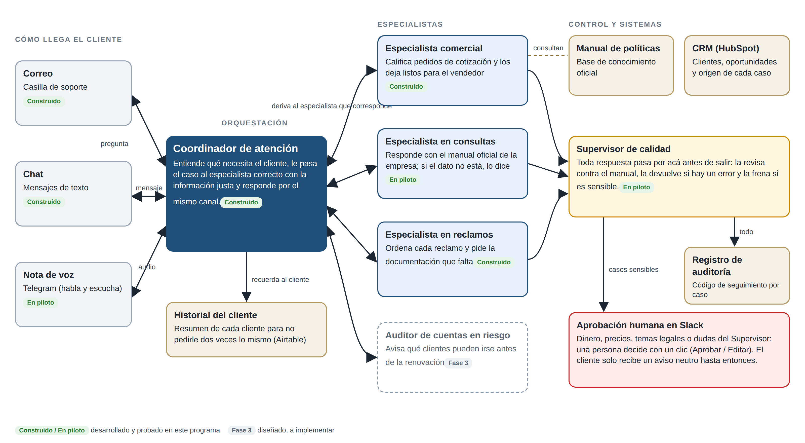

# Checkpoint 10 · Propuesta técnico-comercial (brochure)

**Alumna:** Carla Baudino · **Curso:** AI Automation Avanzado · **Entrega:** [`PreEntrega_Modulo10_CarlaBaudino.pdf`](PreEntrega_Modulo10_CarlaBaudino.pdf)

Este checkpoint es un **documento comercial**, sin workflow nuevo en n8n. Presenta el sistema construido hasta el Checkpoint 9 como un servicio, en el lenguaje de un comité de dirección.

## Contenido del informe

| Sección | Qué incluye |
|---|---|
| 1. Narrativa ejecutiva y arquitectura de valor | El problema (90 consultas por día, 6 minutos cada una, 5 horas hábiles de espera), la promesa, el mapa Coordinador → especialistas → Supervisor → persona en Slack (en página horizontal), la tabla función → beneficio y el business case, con el costo de operación desglosado (USD 0,76 cada 1.000 consultas × 1,89 = USD 1,44 de IA) |
| 2. Roadmap por horizontes | Despliegue por etapas, estrategia de respaldo ante errores o demoras y tablero de indicadores con responsable de medición y periodicidad |
| 3. Modelo comercial e incentivos | Implementación, retainer mensual y success fee por consulta resuelta, con su KPI de facturación y la ventana de conversión |
| 4. Plan de implementación a 30 días | Hitos desde el lunes 2/11/2026, trazabilidad de metadatos con el CRM como única fuente de verdad y tres objeciones del comité respondidas |

## Números clave

| | Valor |
|---|---|
| Implementación | USD 1.200 (pago único) |
| Retainer | USD 180 por mes |
| Success fee | USD 0,08 por consulta resuelta confirmada (tope USD 150 por mes) |
| Beneficio neto para el cliente | USD 528 por mes |
| Recupero de la inversión | 2,3 meses |
| ROI primer año / segundo año | 83 % / 127 % |

Los valores de precio son una propuesta ilustrativa sobre una empresa ficticia.
